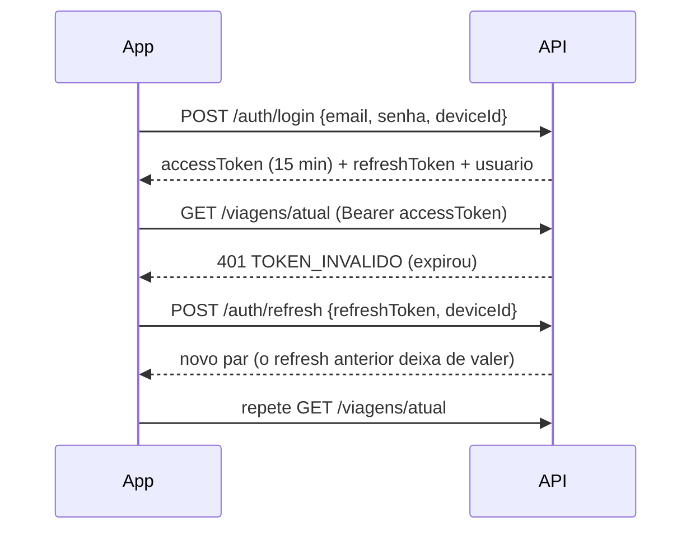

# API

Todas as rotas ficam em `/api/v1`. A referência completa, gerada do próprio código, está no **Swagger**:

- desenvolvimento: `http://localhost:3333/api/v1/docs`
- staging: `https://api-staging.onbus.online/api/v1/docs`
- documento OpenAPI 3.0 (para importar no Postman/Insomnia ou gerar clientes): `/api/v1/openapi.json`

Em produção o Swagger fica desligado.

## Convenções

| Assunto | Regra |
|---|---|
| Sucesso | `{ "data": ... }` |
| Erro | `{ "error": { "code", "message", "details?", "requestId" } }` |
| Códigos de erro | estáveis, no catálogo [`errors/catalogo.ts`](../backend/src/errors/catalogo.ts); o app decide pelo `code`, nunca pelo texto |
| Validação | `VALIDACAO` (400), com os campos em `details` |
| Autenticação | `Authorization: Bearer <accessToken>` |
| Datas | dias `AAAA-MM-DD`, horários `HH:MM`, instantes em ISO 8601 |
| Listas grandes | paginadas com `pagina` e `porPagina`; a resposta traz `itens`, `total`, `pagina`, `porPagina` |
| Rastreio | cada resposta tem o cabeçalho `X-Request-Id`, o mesmo do log e do Sentry |

## Sessão

- `POST /auth/logout` encerra o aparelho atual; `POST /auth/logout-todos` encerra todos.
- Limites de tentativas por IP em login, cadastro e refresh (`RATE_LIMIT_*`).

## Recursos

| Grupo | Rotas principais |
|---|---|
| Autenticação | `/auth/cadastro`, `/auth/login`, `/auth/refresh`, `/auth/me`, `/auth/sessoes` |
| Histórico | `/viagens/historico` (paginado, com filtros e totais), `/viagens/:id/detalhe` (passageiros e horários) |
| Viagens | `/viagens`, `/viagens/atual`, `/viagens/:id/checkin`, `/viagens/:id/iniciar`, `/viagens/:id/encerrar`, `/viagens/:id/passageiros`, `/viagens/:id/rota` |
| Embarque | `/viagens/:id/embarque/sessao` (QR do motorista), `/scan` (aluno), `/manual` |
| GPS | `/viagens/:id/localizacao` (envio e última posição), `/viagens/:id/trajeto`, `/viagens/ao-vivo` |
| Alunos | `/alunos`, `/alunos/:id`, `/alunos/me`, `/alunos/me/dias`, `/alunos/:id/status` |
| Programação | `/programacoes`, `/programacoes/:id/ocupacao`, `/programacoes/gerar` |
| Documentos | `/documentos` (envio e fila), `/documentos/:id/aprovar`, `/reprovar`, `/link` |
| Faltas | `/faltas`, `/faltas/me`, `/faltas/:id/justificativa`, `/justificar`, `/indeferir` |
| Cadastros | `/universidades`, `/onibus`, `/rotas`, `/motoristas`, `/pontos-embarque` |
| Avisos e push | `/notificacoes`, `/notificacoes/dispositivos`, `/notificacoes/preferencias` |
| Dashboard | `/dashboard/resumo`, `/ocupacao-semanal`, `/relatorio` |
| Operação | `/saude`, `/app/versao` |

Cada rota no Swagger mostra o resumo, quem pode chamar (permissão e papéis), os parâmetros e o corpo esperado.

## Regras de negócio principais

- **Senha forte** ao criar uma senha (cadastro do aluno, motorista e administrador): 8+ caracteres com maiúscula,
  minúscula, número e caractere especial (`auth/senha.ts`; o app usa a mesma regra em `utils/senha.ts`). O login
  aceita as senhas antigas.

- **Vaga por dia da semana**: o aluno escolhe dias fixos (`PUT /alunos/me/dias`) dentro da capacidade de cada dia. Com
  algum dia lotado, a resposta é `409` com a lista dos dias. A checagem roda em transação com trava na programação.
- **Viagens geradas sozinhas**: cada programação ativa gera a ida e a volta dos próximos `DIAS_GERACAO_VIAGENS` dias.
  Os alunos alocados entram como `PROGRAMADO`.
- **Check-in e lista de espera**: sem vaga, o aluno entra na espera; ao liberar uma vaga, o primeiro da fila sobe e é
  avisado.
- **Embarque**: o motorista mostra um QR temporário (`BOARDING_QR_MINUTOS`) e o aluno escaneia; sem câmera, o motorista
  confirma manualmente.
- **Faltas**: ao encerrar a ida, quem tinha vaga e não embarcou recebe falta. O aluno justifica (com anexo) e a
  administração decide.
- **Documentos**: a conta nasce `PENDENTE`; ao aprovar o comprovante, a conta fica `ATIVO` e os dias pedidos são
  confirmados onde houver vaga.
- **GPS**: o motorista envia lotes de posições; o aluno só vê o ônibus da viagem em que tem vaga, enquanto ela está em
  andamento. As posições são apagadas depois de `GPS_RETENCAO_DIAS`.

## Como adicionar uma rota

1. No módulo (`src/modules/<assunto>/`), declare o schema zod **exportado** e use-o com `.parse()` na rota.
2. Proteja com `autenticar` e `exigir("<permissão>")`. Permissão nova vai em
   [`auth/permissoes.ts`](../backend/src/auth/permissoes.ts).
3. Lance erros com `new AppError("CODIGO")`; código novo vai no catálogo, com status e mensagem.
4. Registre a rota em [`docs/rotas.ts`](../backend/src/docs/rotas.ts) com o resumo e o schema. O teste
   `docs/openapi.test.ts` falha enquanto isso não for feito.
5. Sub-roteador novo é montado com `montar(pai, "/caminho", filho)`, para o caminho aparecer na documentação.
6. Lista que cresce com o tempo precisa de paginação ou de um teto (`take`).
7. Cubra a regra com teste unitário (se for pura) ou E2E (se envolver banco).
