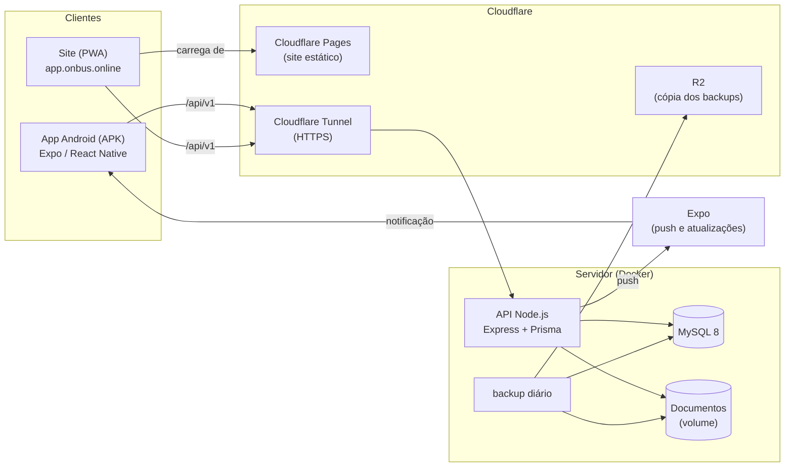
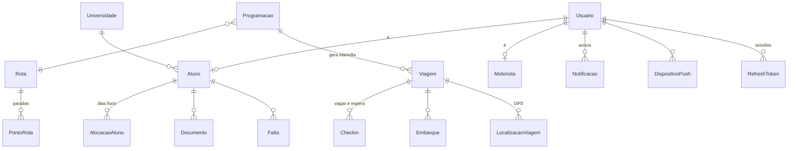

# Arquitetura

O Bus On organiza o transporte universitário de Imperatriz (MA): vagas por dia da semana, check-in, embarque por QR Code,
faltas, documentos de matrícula, avisos no celular e o GPS dos ônibus. São três perfis: **aluno**, **motorista** e
**administração**.

## Visão geral



| Parte | Pasta | Tecnologia |
|---|---|---|
| API | [`backend/`](../backend) | Node.js 24, Express 4, TypeScript, Prisma 5, MySQL 8, Zod, JWT, Pino, Sentry |
| App e site | [`mobile/`](../mobile) | Expo SDK 57 (React Native 0.86, React 19), React Navigation 7, TanStack Query, Zustand |
| Implantação | [`deploy/`](../deploy) | Docker Compose, Cloudflare Tunnel, scripts PowerShell |
| CI | [`.github/workflows/`](../.github/workflows) | GitHub Actions, CodeQL, Dependabot |

O mesmo código do app gera o **APK Android** (EAS Build) e o **site** (`expo export -p web`). Veja os ADRs em
[`docs/adr/`](./adr) para o porquê de cada escolha.

## API

### Camadas

```
src/
├── server.ts          sobe o HTTP, os agendadores e o desligamento gracioso (SIGTERM)
├── app.ts             middlewares globais (log, helmet, CORS, JSON, envelope, erros)
├── instrumentacao.ts  Sentry (primeiro import)
├── config/            env.ts (variáveis validadas com zod), logger (Pino), prisma
├── middlewares/       autenticar/exigir (JWT e permissões), rate limit, envelope, erros
├── auth/permissoes.ts permissões por papel
├── errors/            AppError + catálogo de códigos de erro
├── routes/            agregador (/api/v1) e montar() dos sub-roteadores
├── modules/<assunto>/ *.routes.ts (HTTP + validação zod) e *.service.ts (regras + Prisma)
├── storage/           arquivos dos alunos (disco local) e detecção de formato
├── backup/            backup e restauração (mysqldump + tar, cópia no R2)
├── docs/              OpenAPI gerado das rotas (Swagger em /api/v1/docs fora da produção)
└── utils/             datas, JWT, senha, links assinados
```

- **Rotas** validam a entrada com zod e chamam o serviço. Os schemas são exportados para a documentação OpenAPI.
- **Serviços** concentram as regras. Operações que disputam vaga (check-in, dias fixos) rodam em transação com
  `SELECT … FOR UPDATE` na viagem ou na programação.
- **Respostas**: sucesso em `{ data }`; erro em `{ error: { code, message, details?, requestId } }`, com `code`
  estável vindo de [`errors/catalogo.ts`](../backend/src/errors/catalogo.ts).
- **Permissões**: as rotas exigem permissões (`exigir("alunos:ler")`), não papéis. O mapa papel → permissões fica em
  [`auth/permissoes.ts`](../backend/src/auth/permissoes.ts).
- **Auditoria**: mudanças sensíveis (status da conta, documentos, dias, faltas, cadastros) gravam antes/depois na
  tabela `Auditoria`.

### Sessão

- Login devolve um **access token** JWT (15 min) e um **refresh token** opaco (guardado como hash, um por aparelho).
- `POST /auth/refresh` faz **rotação**: devolve um par novo e invalida o anterior. Reuso de um refresh já trocado (sinal de
  roubo) encerra as sessões daquele aparelho.
- O app renova sozinho ao receber 401 (várias requisições esperam a mesma renovação).

### Tarefas em segundo plano

Rodam dentro do processo da API, com `setInterval(...).unref()`:

| Tarefa | Onde | Frequência |
|---|---|---|
| Gerar as viagens de ida/volta dos próximos dias | `programacoes/programacao.service.ts` | ao subir e a cada hora |
| Fila de push (envio e conferência de recibos) | `push/push.service.ts` | `PUSH_INTERVALO_MS` e `RECIBOS_INTERVALO_MS` |
| Lembretes de viagem (véspera e saída) | `push/lembretes.service.ts` | `LEMBRETES_INTERVALO_MS` |
| Limpeza das posições de GPS antigas | `gps/localizacao.service.ts` | a cada 6 h |

Todas são idempotentes. Hoje há **uma** instância da API; para mais de uma, seria preciso um lock (ou um worker
separado) para essas tarefas.

### Dados

O schema completo está em [`prisma/schema.prisma`](../backend/prisma/schema.prisma) (23 tabelas). Os grupos principais:



- **Datas de calendário** (`AAAA-MM-DD`) e horários (`HH:MM`) usam o fuso do servidor (`TZ=America/Fortaleza`).
- **Arquivos** dos alunos ficam fora do banco (volume `uploads`) e só abrem por link assinado de 5 minutos.

## App e site

```
mobile/
├── App.tsx                 provedores (tema, React Query, navegação, Sentry, atualização)
├── app.json / app.config.ts configuração do Expo (variantes oficial e Teste)
├── eas.json                perfis de build e endereço da API de cada ambiente
├── scripts/                build do site, EAS e publicação de atualização
└── src/
    ├── features/<assunto>/ telas + api.ts (hooks do React Query) de cada assunto
    ├── components/         design system (Tela, Card, Botao, Campo, Folha, Pilula...)
    ├── navigation/         RootNavigator (abas de cada perfil carregadas sob demanda)
    ├── hooks/              useDadosDaTela (foco, intervalo, puxar para atualizar)
    ├── services/           api (axios + renovação), tokens (SecureStore), queryClient
    ├── store/              sessão (Zustand)
    ├── theme/              tokens de cor/tipografia, tema claro e escuro
    ├── types/              tipos das respostas da API
    └── utils/              datas, máscaras, rótulos, feedback
```

- **Dados do servidor**: TanStack Query. Cada assunto tem um `api.ts` com as chaves de cache e os hooks
  (`useMeusDados`, `useListaAlunos`...). Telas que mostram os mesmos dados compartilham o cache. Veja [app.md](./app.md).
- **Estado local**: Zustand só para a sessão; o resto fica nas telas.
- **Arquivos por plataforma**: `Arquivo.web.tsx` substitui `Arquivo.tsx` no site (mapa, moldura, instalação).
- **Site**: as abas de cada perfil são carregadas sob demanda (arquivos JS separados), e só o Ionicons entra no pacote.

## Ambientes

| | Desenvolvimento | Staging | Produção |
|---|---|---|---|
| API | `localhost:3333` | `api-staging.onbus.online` | `api.onbus.online` |
| Site | `localhost:8081` | `app-staging.onbus.online` | `app.onbus.online` |
| App | Expo Go / dev build | APK "Bus On Teste" | APK "Bus On" |
| Swagger | `/api/v1/docs` | `/api/v1/docs` | desligado |
| Dados | seed de demonstração | dados de teste | reais |

Detalhes de implantação em [deploy.md](./deploy.md).
