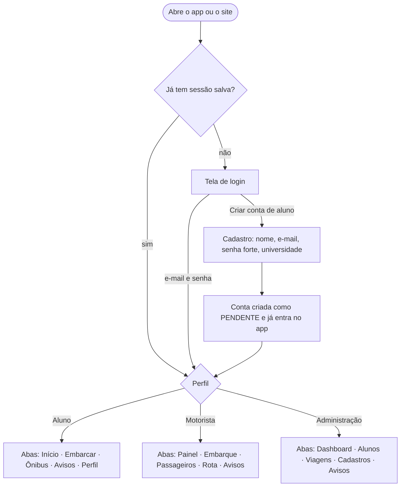
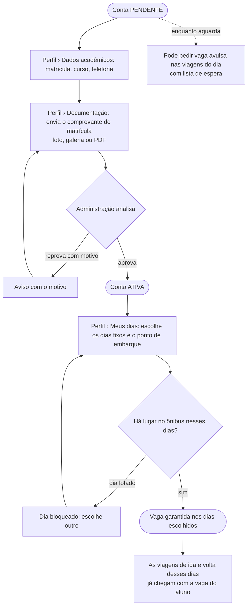
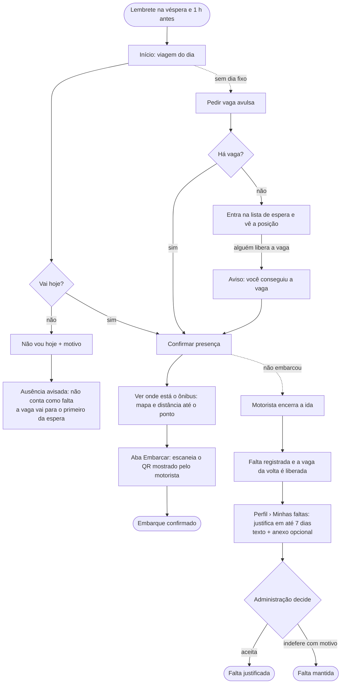
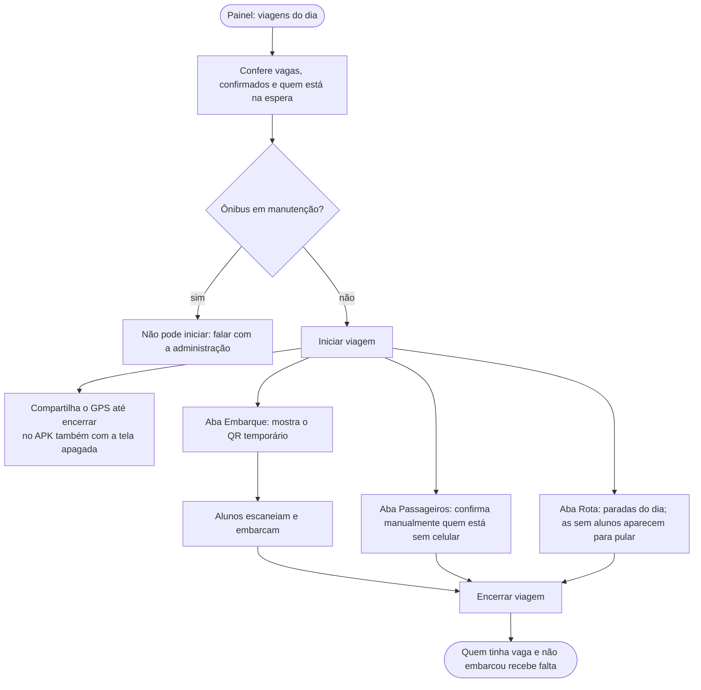
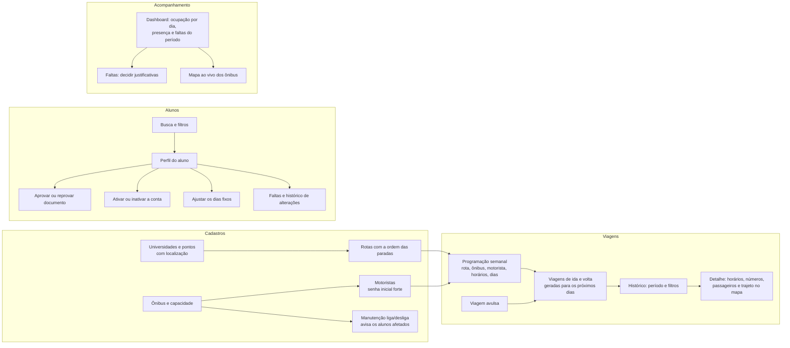
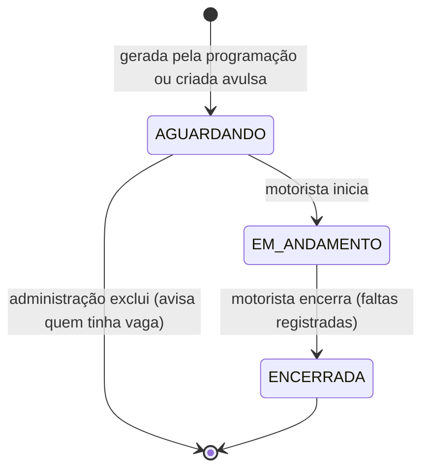
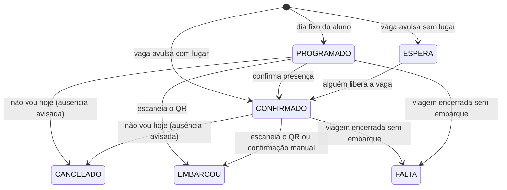

# Fluxos de uso

Como cada perfil usa o Bus On, do primeiro acesso ao dia a dia. Os diagramas são Mermaid (o GitHub desenha sozinho).
As regras por trás de cada passo estão em [api.md](./api.md#regras-de-negócio-principais).

## 1. Entrada no app

- **Senha forte** ao criar conta: 8+ caracteres, com maiúscula, minúscula, número e caractere especial (a tela marca
  cada item enquanto a pessoa digita).
- Motoristas não se cadastram: a administração cria a conta. O primeiro administrador é criado no servidor
  (`criar-admin`).
- A sessão se renova sozinha; "Sair de todos os aparelhos" encerra todas as sessões.

## 2. Aluno: do cadastro à vaga garantida

## 3. Aluno: o dia da viagem

## 4. Motorista: a viagem

## 5. Administração

## 6. Ciclo da viagem e da vaga

## 7. Avisos

Cada evento gera um aviso na aba **Avisos** (com contador) e, no APK, uma notificação no celular:

| Para quem | Quando |
|---|---|
| Aluno | documento em análise, aprovado ou reprovado; conta ativada ou inativada; vaga confirmada, liberada ou conseguida na espera; mudanças nos dias fixos e na rota; lembretes da viagem; ônibus em manutenção; viagem cancelada; falta registrada e decisão da justificativa |
| Motorista | lembretes das viagens dele (na véspera e antes da saída, com o número de passageiros) |
| Administração | aluno novo cadastrado, documento para analisar, justificativa de falta enviada, aluno com 3 faltas sem justificativa em 30 dias |

Em *Avisos › ⚙* cada pessoa desliga os lembretes e os avisos de vaga no celular; os avisos de cadastro, documentos,
faltas e viagem cancelada sempre chegam.
